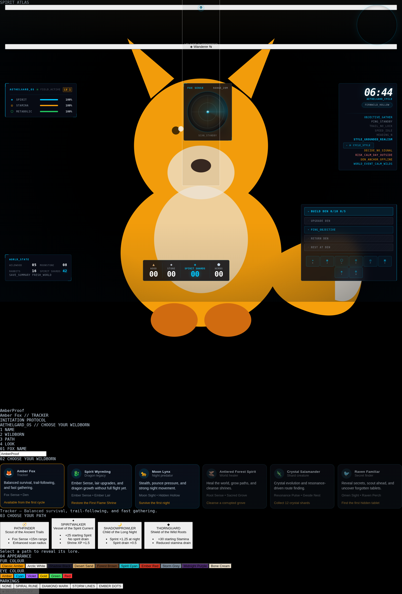
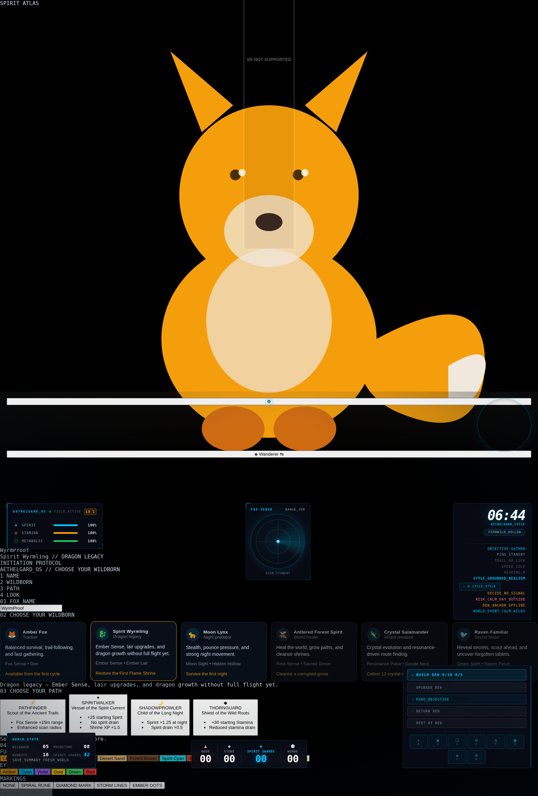
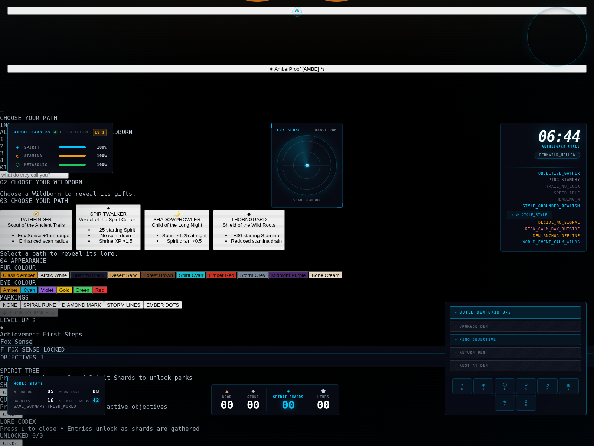
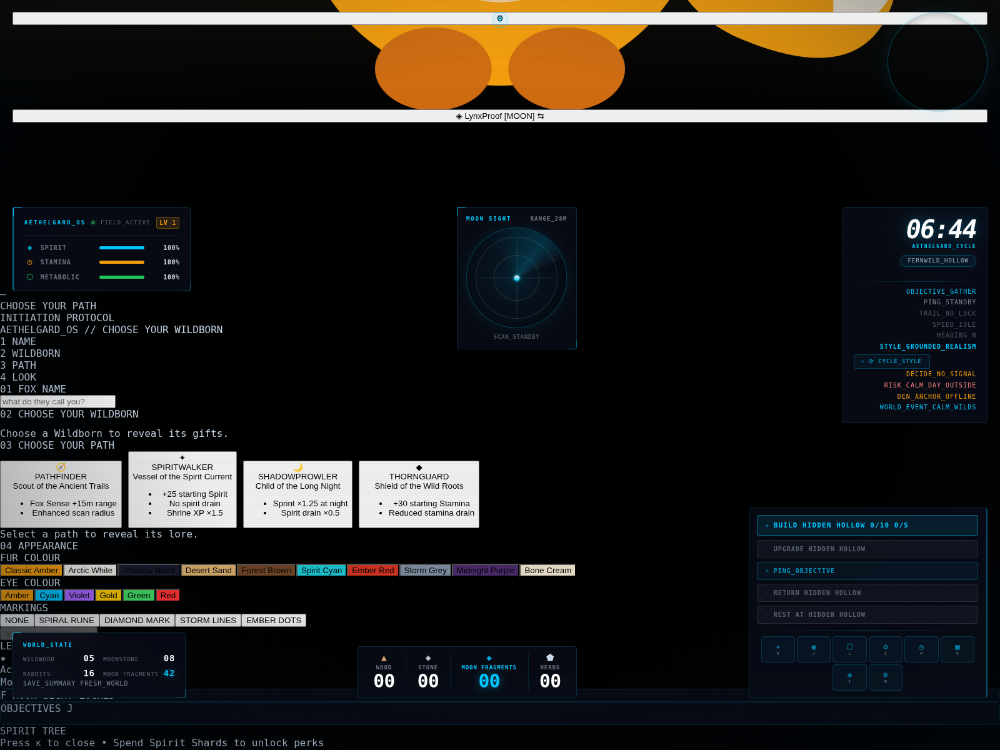
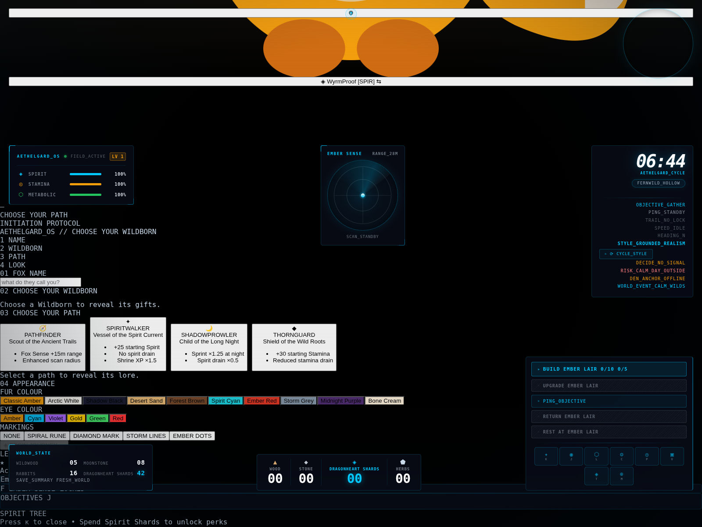
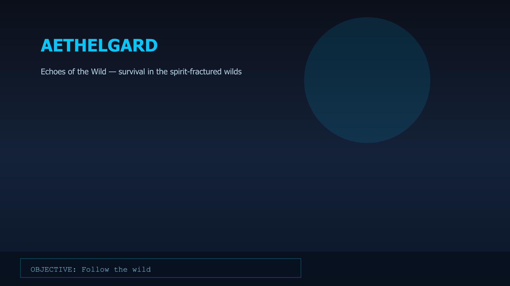
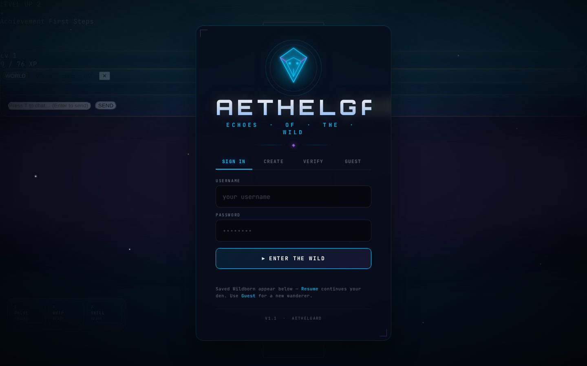

# Aethelgard

- **Repo:** `Aethelgard`
- **Branch:** `main`
- **Exact HEAD:** `18c0e4017e48d56d23750aea887964db3281758e`
- **Commit date:** 2026-07-19T13:21:33+08:00
- **Proof status:** `HAS_PHOTOS_ONLY`
- **Photos:** 8
- **Videos:** 0

Browser Three.js world / Wildborn baseline (known boot hang on current main).

> Note: AGENTS.md notes orphaned top-level ReferenceError blocks in-world boot.

## Photos

### `docs/release/wildborn-baseline/amber-fox-select.png`

- sha256: `b7b0d657317a840d5dd6ab5fef1c8ca6eea0285ebf5decb74c1b14c2f8e927c5`
- source HEAD: `18c0e40`

### `docs/release/wildborn-baseline/moon-lynx-select.png`

- sha256: `9965c1da223acbd03c0ff2fcd89d1367edaad5b76126c66af8643a63a4083f71`
- source HEAD: `18c0e40`

### `docs/release/wildborn-baseline/spirit-wyrmling-select.png`

- sha256: `b2279b1aade8fa00578bba9128803aba964d3e7a52bd08781876114c7c33ef42`
- source HEAD: `18c0e40`

### `docs/release/wildborn-baseline/amber-fox-hud.png`

- sha256: `f3bb64087567d1a8c67753ec2ae7066d632b9f1bca1420eceb7d5ab9cd084543`
- source HEAD: `18c0e40`

### `docs/release/wildborn-baseline/moon-lynx-hud.png`

- sha256: `259eea0f5f8d5e60bb583920018cc01214682752d45469e53b17f82caa124369`
- source HEAD: `18c0e40`

### `docs/release/wildborn-baseline/spirit-wyrmling-hud.png`

- sha256: `03fd540bcffab2471d8753a92d4c3e2417666fe0bdf2b371037b53c2da8a8d0e`
- source HEAD: `18c0e40`

### `public/screenshot-wide.png`

- sha256: `a70abe3e771a9f7a89568c4db8329abd3e6b1897acf62c87a1c1c8c745d64a01`
- source HEAD: `18c0e40`

## Fresh runtime captures (this audit pack)

- Captured at: `2026-11-24T10:44:45.052155+00:00`
- Against exact HEAD: `18c0e4017e48d56d23750aea887964db3281758e`
- Tool: Playwright Chromium (software GL)
- Class: `FRESH_RUNTIME_CAPTURE` — useful for audit; not LAW phone/release certification.

### `01-boot-ui.png`

- sha256: `b089d57e2ad7bfb67809ef8a9b08f08a00b1ca18af212c99862bb03212137729`

