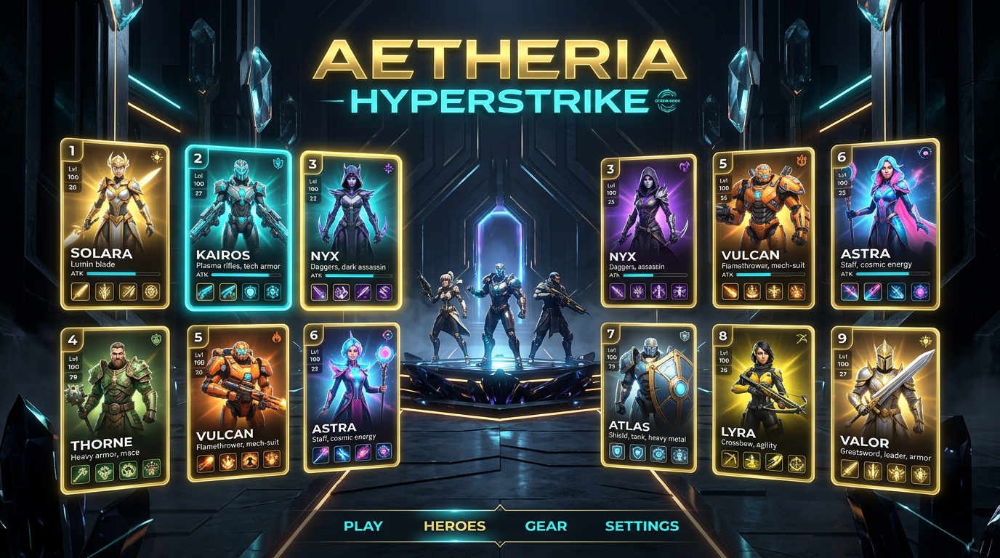
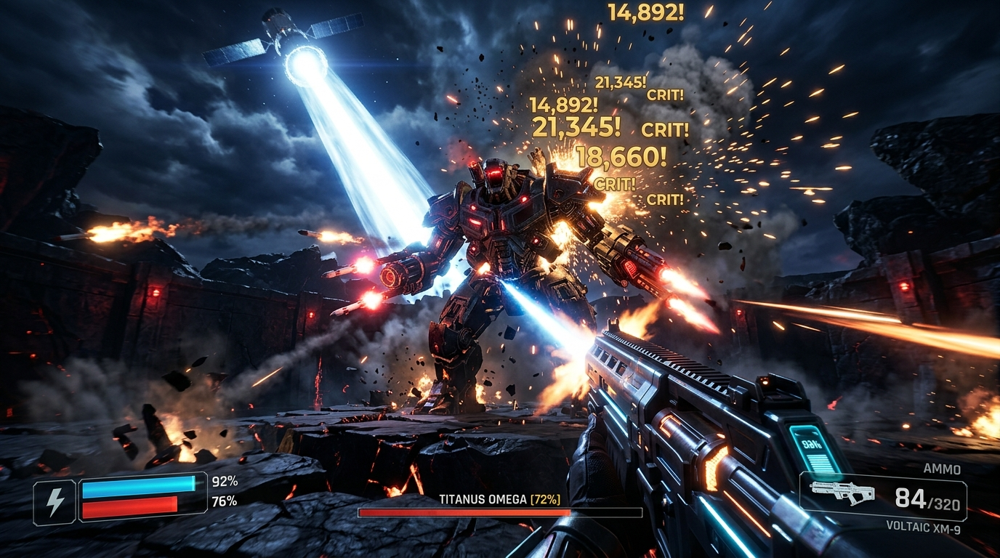
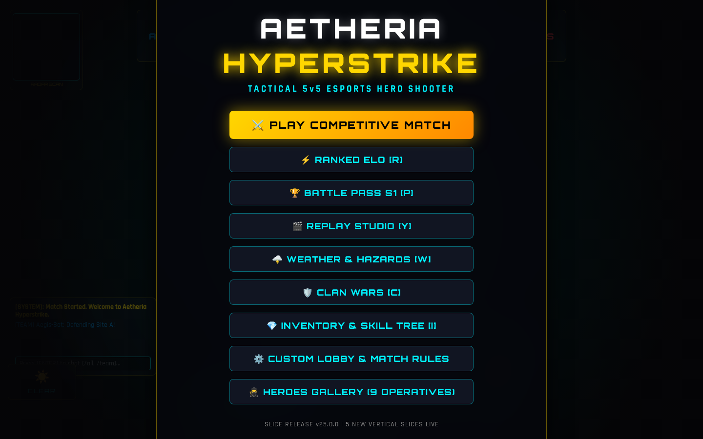

# Aetheria: Hyperstrike (Web)

- **Repo:** `-Aetheria-Hyperstrike-Web`
- **Branch:** `main`
- **Exact HEAD:** `1f9300ba2331be23d81e3abbcde44ee160fa1244`
- **Commit date:** 2026-08-07T07:24:17+08:00
- **Proof status:** `HAS_PHOTOS_ONLY`
- **Photos:** 3
- **Videos:** 0

Browser game prototype with main-menu and combat proof shots.

## Photos

### `artifacts/hyperstrike-proof/main_menu_super_art.jpg`

- sha256: `03d5e81ed67f5d4c95fe4f5ad318aacc6c791e02b7a43902a04da572ce72ab83`
- source HEAD: `1f9300b`

### `artifacts/hyperstrike-proof/combat_boss_encounter.jpg`

- sha256: `9d00b9a3e9d5358f33b60ba1d479c94754e4961c039b495ca9e2ea643fe0f99e`
- source HEAD: `1f9300b`

## Fresh runtime captures (this audit pack)

- Captured at: `2026-11-24T10:44:45.052155+00:00`
- Against exact HEAD: `1f9300ba2331be23d81e3abbcde44ee160fa1244`
- Tool: Playwright Chromium (software GL)
- Class: `FRESH_RUNTIME_CAPTURE` — useful for audit; not LAW phone/release certification.

### `01-boot-ui.png`

- sha256: `2658707673b467b335dda7c0bb739e28b37ae5e19299bdf8cef3b76fc9462245`

