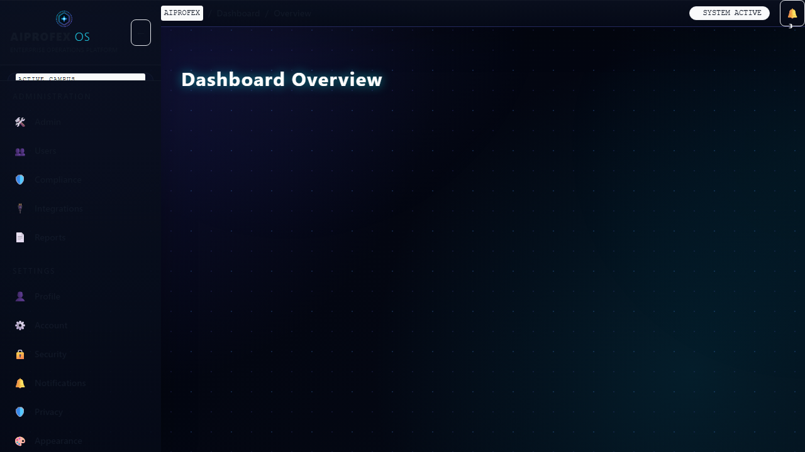
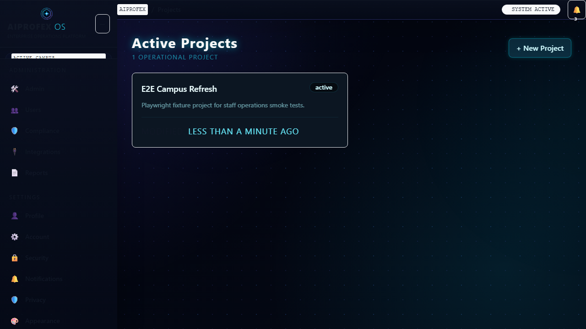
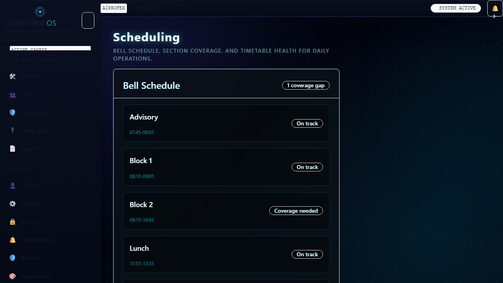
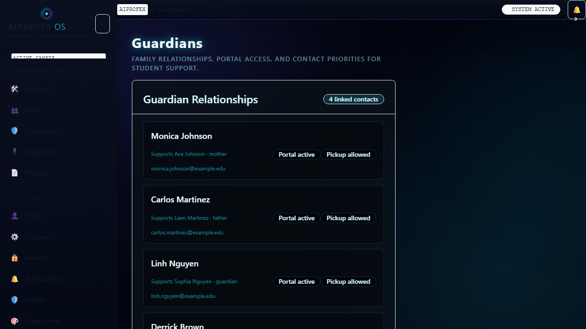
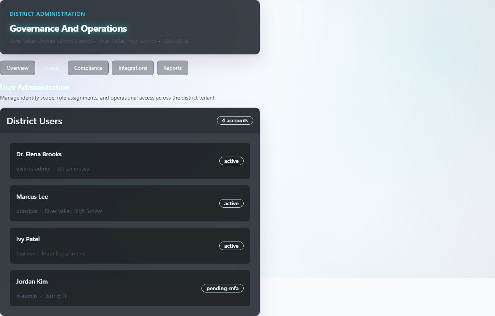
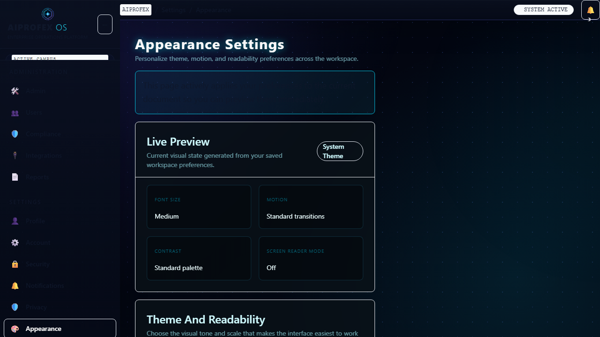
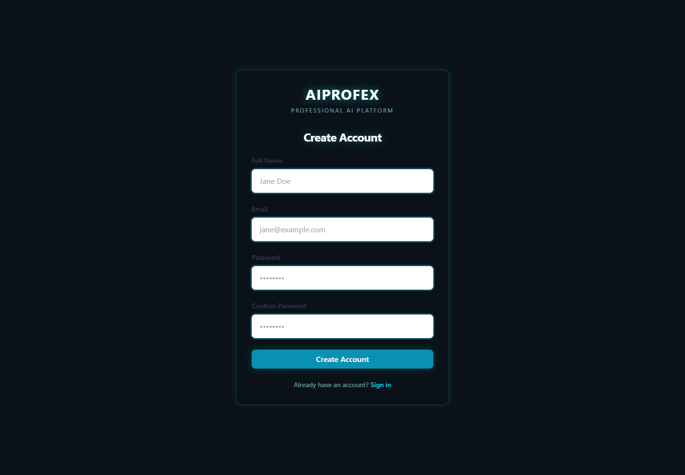

# AIProfex.OS

- **Repo:** `aiprofex-os`
- **Branch:** `main`
- **Exact HEAD:** `deaf99c7cfe0f7d0b194409328ef34778c9cf743`
- **Commit date:** 2026-08-08T18:07:38+08:00
- **Proof status:** `HAS_PHOTOS_ONLY`
- **Photos:** 7
- **Videos:** 0

Education / operations OS with dashboard, scheduling, and admin surfaces.

## Photos

### `docs/screenshots/dashboard-overview.png`

- sha256: `2cb95e0f0d384893150129b97db17f40adbe4b02c4f163383edf4839318c3c87`
- source HEAD: `deaf99c`

### `docs/screenshots/projects.png`

- sha256: `ad607654ac7d00ebfd17c278cc311564ae9ac3fe79a39d9585ed13d533094808`
- source HEAD: `deaf99c`

### `docs/screenshots/scheduling.png`

- sha256: `5f6ade3de210f4204e0588c16de52b202ec6bd5c874aa9a30a60bed7931b0b02`
- source HEAD: `deaf99c`

### `docs/screenshots/guardians.png`

- sha256: `04ba7cc4e310cdd745f550bebd19f45887d10c035480b74af57342cf72c5743a`
- source HEAD: `deaf99c`

### `docs/screenshots/admin-users.png`

- sha256: `d0dd59bee0583cfd5cce671fb9d982825ecf0cca8b11a308c63f4f22d742f55d`
- source HEAD: `deaf99c`

### `docs/screenshots/settings-appearance.png`

- sha256: `393d630b852d77d9edb9d26330a5b031fb6fe769d895e5c94a599ea5224864c5`
- source HEAD: `deaf99c`

### `evidence/auth-production-proof/01-register-page.png`

- sha256: `8de05aa7a9b5af2debacc3233ed4aeeb1f00c59ee8c483851e0f74758884bfcb`
- source HEAD: `deaf99c`
