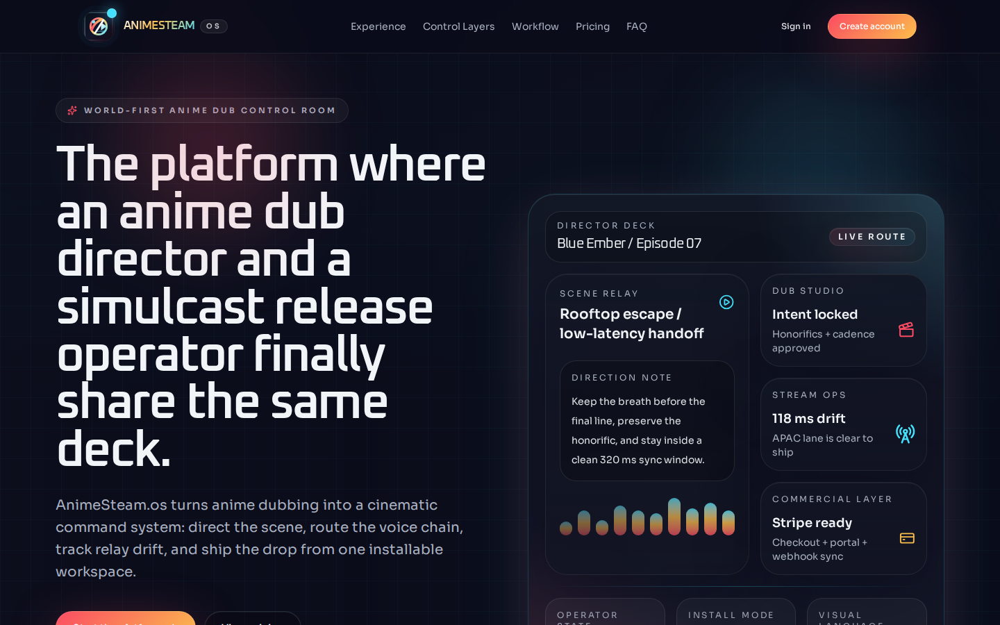
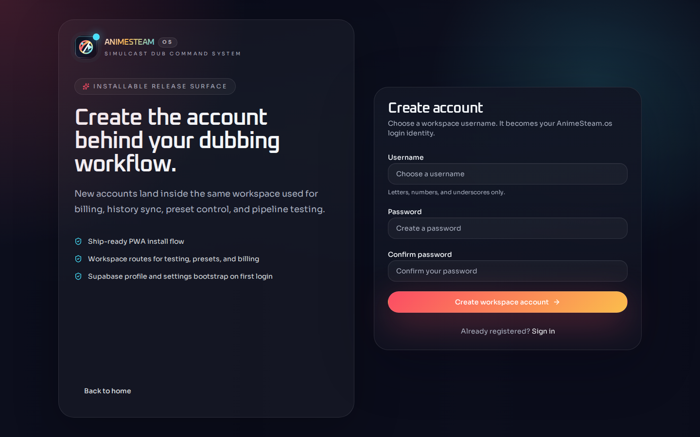

# AnimeSteam.OS

- **Repo:** `animesteam-os`
- **Branch:** `main`
- **Exact HEAD:** `c2e6beaec4c8a9a1eaf878521dab5fb00ac0a2f4`
- **Commit date:** 2026-07-17T18:22:01+08:00
- **Proof status:** `HAS_PHOTOS_AND_VIDEOS`
- **Photos:** 2
- **Videos:** 1

Anime-focused OS web app (icons only; no UI screenshots found).

## Fresh runtime captures (this audit pack)

- Captured at: `2026-11-24T10:44:45.052155+00:00`
- Against exact HEAD: `c2e6beaec4c8a9a1eaf878521dab5fb00ac0a2f4`
- Tool: Playwright Chromium (software GL)
- Class: `FRESH_RUNTIME_CAPTURE` — useful for audit; not LAW phone/release certification.

### `01-boot-ui.png`

- sha256: `b4dad98d21395c8b7eb8611cec1b12fa13cef4d8206cde9b3fad88197373dfc3`

### `02-after-cta.png`

- sha256: `7b3a7895648e7dcd7cdfc758affed64a3c539c72d502e36048c7e8c704581c2a`

- [`ui-loop.webm`](fresh-runtime/ui-loop.webm) — sha256 `12aefc152d5a20e6e4a41098574a0b6927ea23c0b5221cc529e736e639a31e88`
