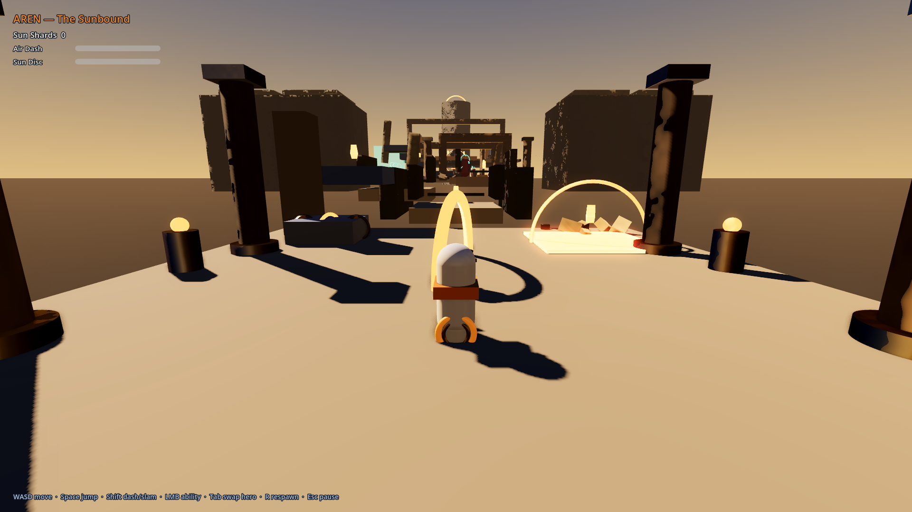
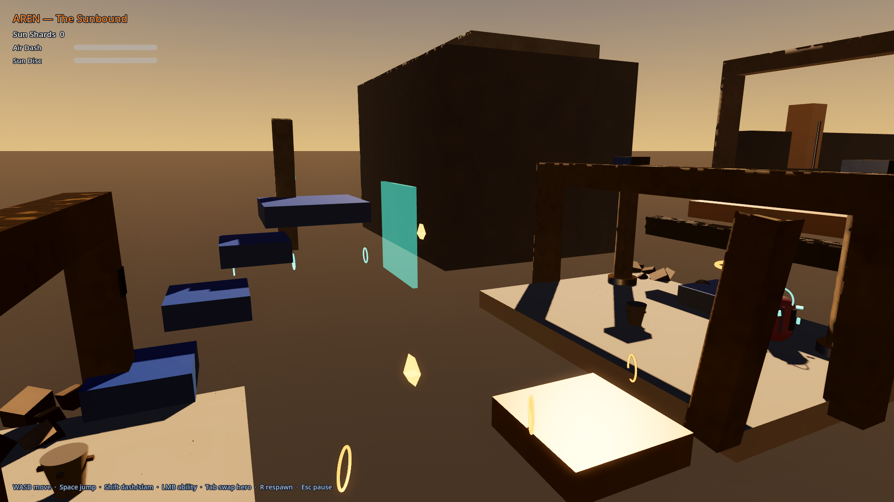
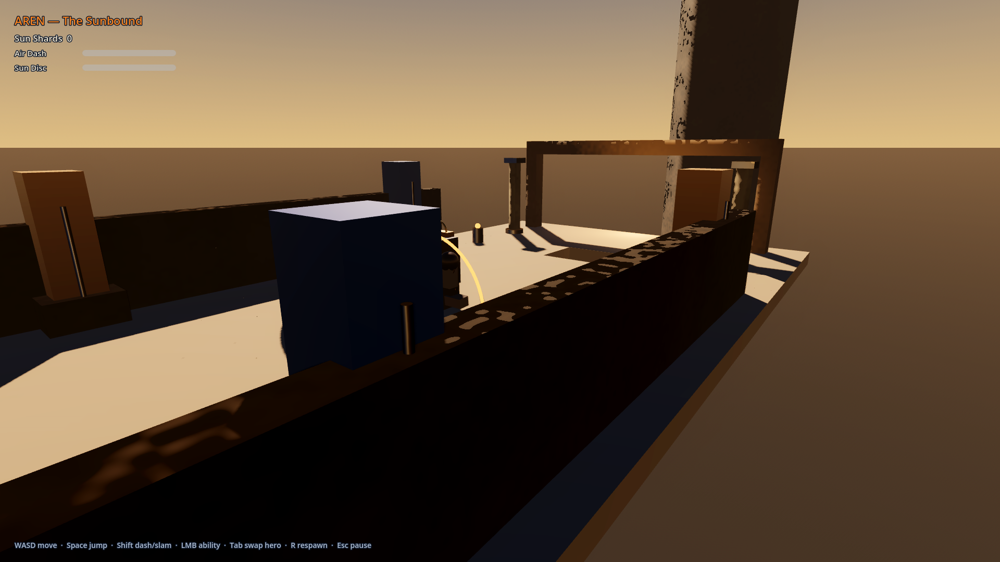
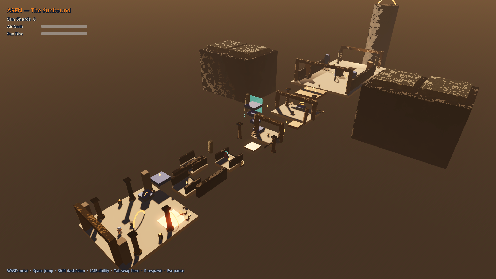
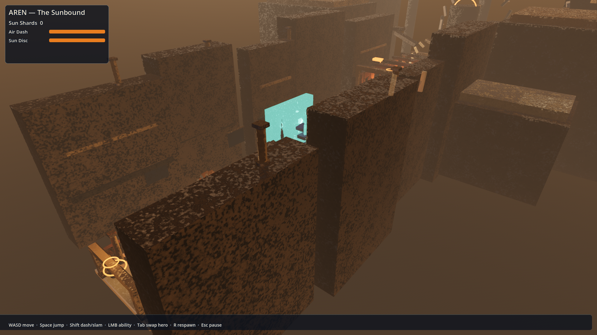

# ASHEN SUN

- **Repo:** `ASHEN-SUN`
- **Branch:** `main`
- **Exact HEAD:** `1d937038a92679ce5e13a2273f7f1b5c0e36a2f0`
- **Commit date:** 2026-11-19T22:53:18+08:00
- **Proof status:** `HAS_PHOTOS_ONLY`
- **Photos:** 6
- **Videos:** 0

Godot desert-temple exploration with software-render and Forward+ proof packs.

## Photos

### `proof/game_capture_software/screens/01_spawn_landing_plaza.png`

- sha256: `06fc1f78735a2193f22bf12cf84c57ff68cf4f4bbbab6c66340e734b3a4da6ab`
- source HEAD: `1d93703`

### `proof/game_capture_software/screens/02_overview_temple_route.png`

- sha256: `e3eebc0f7cc57a62ae581cbde13d66417529655e171e329fe38be04b497b1f2f`
- source HEAD: `1d93703`

### `proof/game_capture_software/screens/03_fork_nekhet_ward.png`

- sha256: `2bee57fb3be7f9fe2f07825721db00557108504d4aaf872e6f4ef7adfc36e7b4`
- source HEAD: `1d93703`

### `proof/game_capture_software/screens/04_guardian_courtyard.png`

- sha256: `74b398ff283ae144cc3f9a88bef6f834e5f2c7043b38f5c20fdb6529e55b28ec`
- source HEAD: `1d93703`

### `evidence/software-render/capture_overview.png`

- sha256: `e3eebc0f7cc57a62ae581cbde13d66417529655e171e329fe38be04b497b1f2f`
- source HEAD: `1d93703`

### `proof/native_forward_plus_visual_v3/screens/overview.png`

- sha256: `0a673d67417cf6f81cd3c5390392ab4d9243cbaf056a36a33c33da8a346747db`
- source HEAD: `1d93703`
