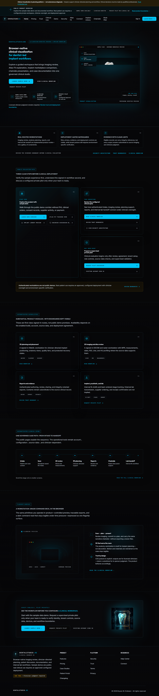
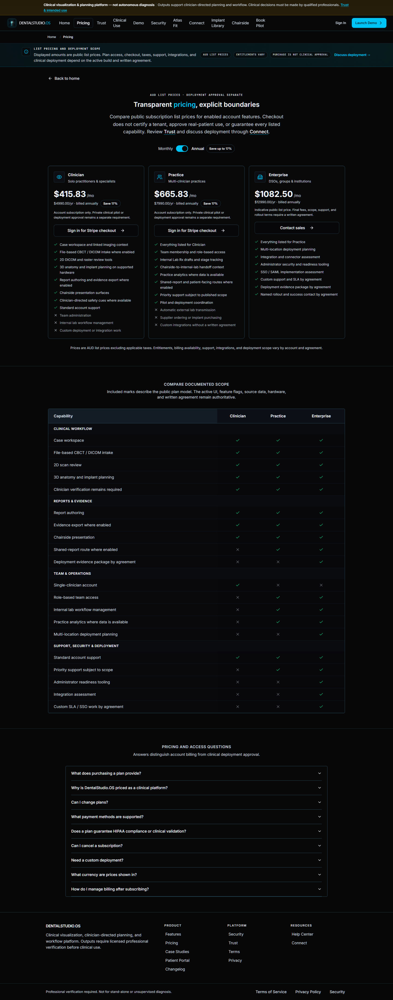
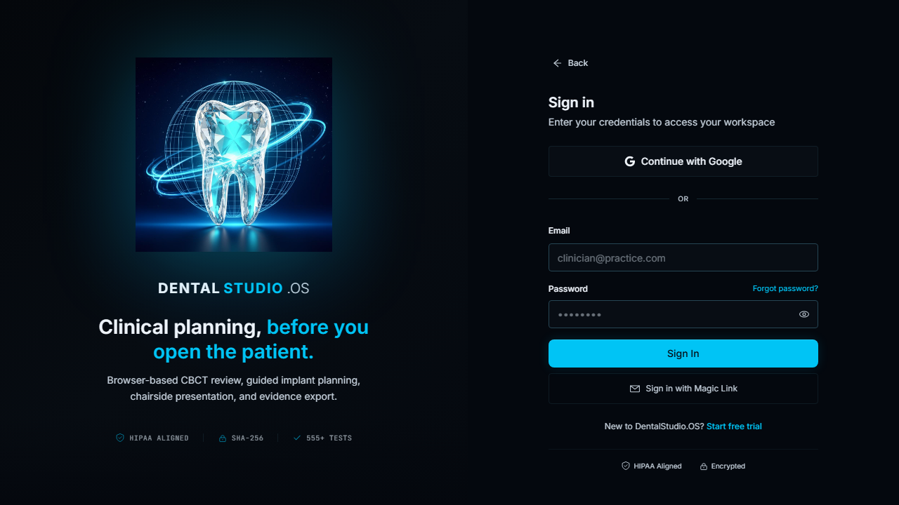
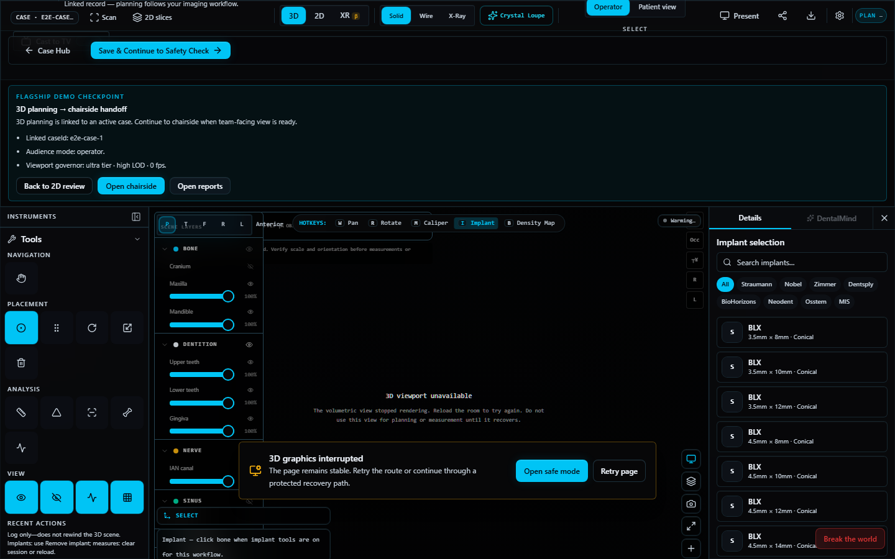
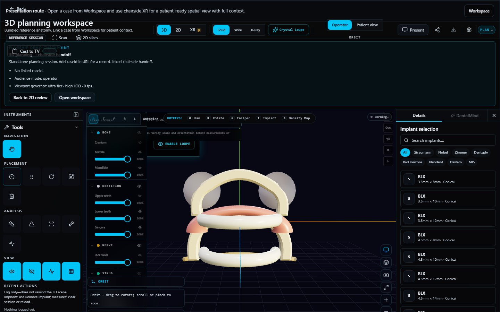
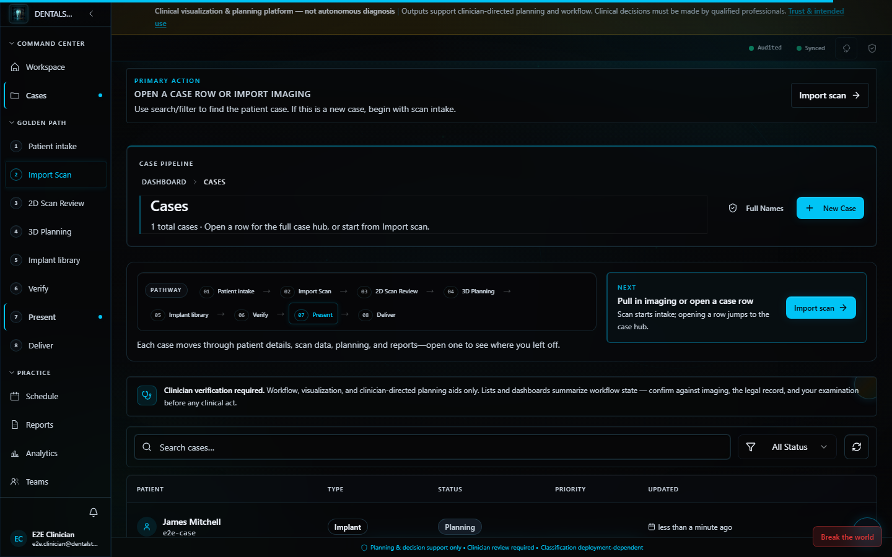

# DentalStudio.OS

- **Repo:** `dentalstudio-os`
- **Branch:** `main`
- **Exact HEAD:** `3418d7f21ecbef0bc374711d94a356118d3570ba`
- **Commit date:** 2026-10-07T00:56:48+08:00
- **Proof status:** `HAS_PHOTOS_AND_VIDEOS`
- **Photos:** 7
- **Videos:** 4

Clinical-grade browser dental planning OS with demo corridor and evidence packs.

## Photos

### `release-evidence/dentist-pilot-final-20260814/browser-proof/screenshots/landing.png`

- sha256: `ec07c2a05efb0e261d4ad5de082fcdc667b6bc949133ea7154be33597bc1a47d`
- source HEAD: `3418d7f2`

### `release-evidence/dentist-pilot-final-20260814/browser-proof/screenshots/pricing.png`

- sha256: `f9443bd820889435b0a5af1ed12e4cbe92253c05927b9c8b54b578ca9d084739`
- source HEAD: `3418d7f2`

### `docs/release/proof-pack/screenshots/cold-open-critical-routes/reports.png`

- sha256: `43d3a99ffe3852b7e79d31d1759a63380030fac96a4ec72b8595c2b03a17d8cb`
- source HEAD: `3418d7f2`

### `e2e-results/phiro-corridor/Implant-Planning.png`

- sha256: `a29d89e8f8067d3f26df8a91ab8d96a6177b2b57f47282036e3bca4b94ed42dc`
- source HEAD: `3418d7f2`

### `e2e-results/phiro-corridor/Presentation-Mode.png`

- sha256: `93944983d688f3545392cff3e4b6fb84b7ee052eeae60843d0a7cf4b196edd7b`
- source HEAD: `3418d7f2`

### `e2e-results/phiro-corridor/Report.png`

- sha256: `01684ab049478b58e665e37cda69dcc9bd1327d4062d9aaa2d5f131bf05b353a`
- source HEAD: `3418d7f2`

### `e2e-results/phiro-corridor/Cases.png`

- sha256: `3fd0b870f3fed7e019739b52ebec5fe9db8246aa84b2cc39360ea6380090ced9`
- source HEAD: `3418d7f2`

## Videos

- [`release-evidence/dentist-pilot-final-20260814/videos/video-1-dentist-core-workflow.mp4`](videos/release-evidence__dentist-pilot-final-20260814__videos__video-1-dentist-core-workflow.mp4) — sha256 `9f0833efe914144832e2cad6a9450f9f85c0a9e305e8924d9bf71d5f527d7870`
- [`release-evidence/dentist-pilot-final-20260814/videos/video-2-ipad-workflow.mp4`](videos/release-evidence__dentist-pilot-final-20260814__videos__video-2-ipad-workflow.mp4) — sha256 `73d5aab1a3ffd143c760427d5a1969e51206f015339a1e78321ac290ad691bbe`
- [`release-evidence/dentist-pilot-final-20260814/videos/video-3-imaging-workflow.mp4`](videos/release-evidence__dentist-pilot-final-20260814__videos__video-3-imaging-workflow.mp4) — sha256 `fe7f1688e22d250203791bb0886693817255bc182dcbb860d5911401ae0e4699`
- [`release-evidence/dentist-pilot-final-20260814/videos/video-5-pilot-overview.mp4`](videos/release-evidence__dentist-pilot-final-20260814__videos__video-5-pilot-overview.mp4) — sha256 `712be186881de76f7b2e1ee20b66073de7050c178aa14ffaf55d995d494bdec2`
