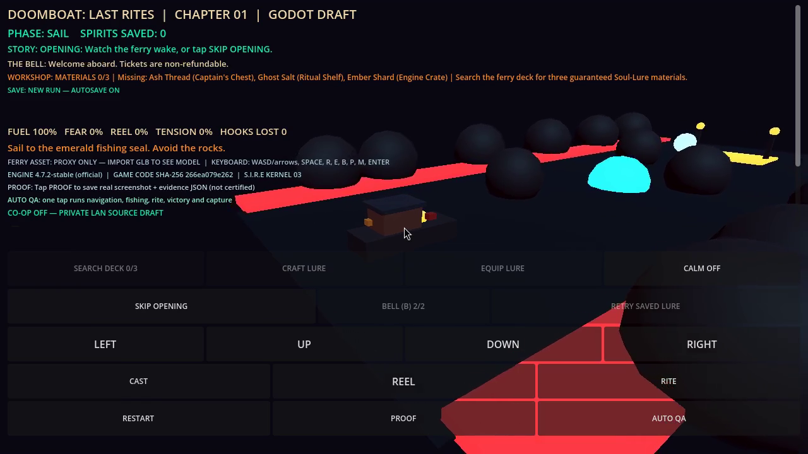

# DOOMBOAT: Last Rights

- **Repo:** `DOOMBOAT-LAST-RIGHTS`
- **Branch:** `main`
- **Exact HEAD:** `6251707dc82a8a1d319e6a453aa9298e7fab603c`
- **Commit date:** 2026-11-24T14:26:00+08:00
- **Proof status:** `HAS_PHOTOS_AND_VIDEOS`
- **Photos:** 1
- **Videos:** 1

KRAIT Godot game (no committed UI screenshots in this checkout).

## Godot engine capture

- Captured at: `2026-11-24T11:18:11.730063+00:00`
- Against exact HEAD: `6251707dc82a8a1d319e6a453aa9298e7fab603c`
- Engine: Godot 4.7.2.stable (hash-matched)
- Preceded by `run_engine_checks.sh` PASS (15 smokes)
- Scope: actual engine window capture — not phone/release certified

- [doomboat-real-scene.mp4](fresh-runtime/doomboat-real-scene.mp4)
- [capture-receipt.json](fresh-runtime/capture-receipt.json)
