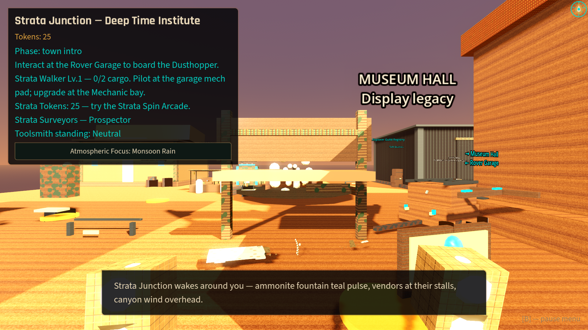
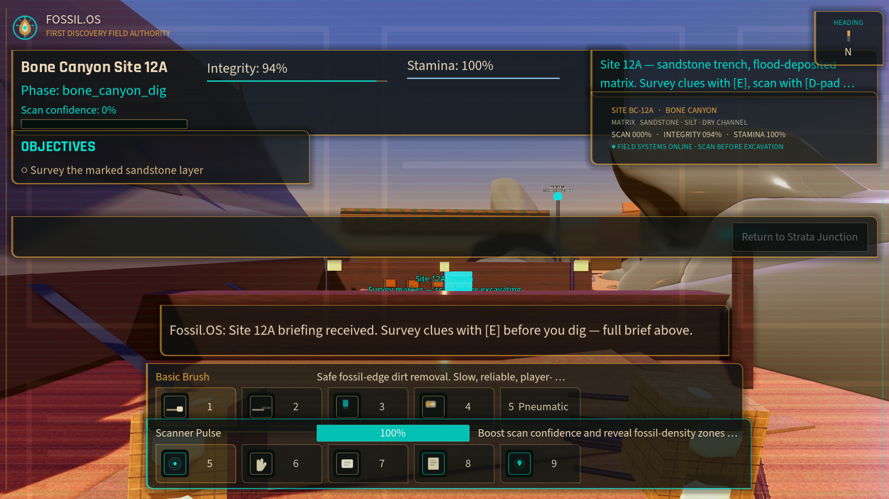
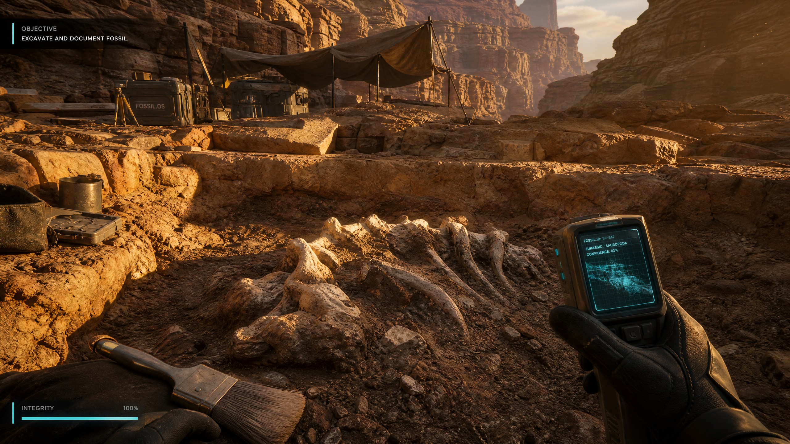

# Fossil.OS

- **Repo:** `Fossil.Os`
- **Branch:** `main`
- **Exact HEAD:** `4a5be540f919a2b28e687352aa1ccfecc53c2af5`
- **Commit date:** 2026-10-28T07:35:15+08:00
- **Proof status:** `HAS_PHOTOS_ONLY`
- **Photos:** 4
- **Videos:** 0

Godot 4.7 fossil expedition loop with visual evidence packs.

## Photos

### `evidence/visual/20260914T112235Z_63ccffb7a874/screens/02_strata_junction.png`

- sha256: `6e2d39d04525e0f6cb0dc606f448e0864e5182097402d298665cfccb017f35c4`
- source HEAD: `4a5be54`

### `evidence/visual/20260914T112235Z_63ccffb7a874/screens/03_bone_canyon.png`

- sha256: `8c3c1d495f00d07bd32ef463bf497f4bafae59f0a63ce980bdb289ed3bc4e1fe`
- source HEAD: `4a5be54`

### `evidence/visual/20260914T112235Z_63ccffb7a874/screens/05_digging_reveal.png`

- sha256: `f4f2173b360e573fb821747f6b655289ba809067a2748bb287aec64e0c53d3bd`
- source HEAD: `4a5be54`

### `Docs/visual_references/bone_canyon_aaa_visual_target.png`

- sha256: `08074e85a6d5314ef32c3551fa6143a756e2835dd899494083bf1522d0bbd001`
- source HEAD: `4a5be54`
