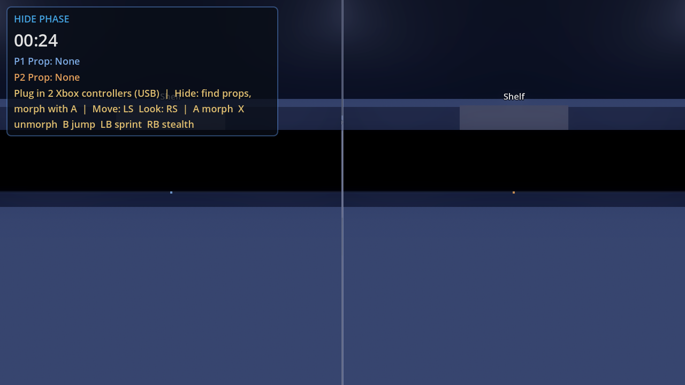
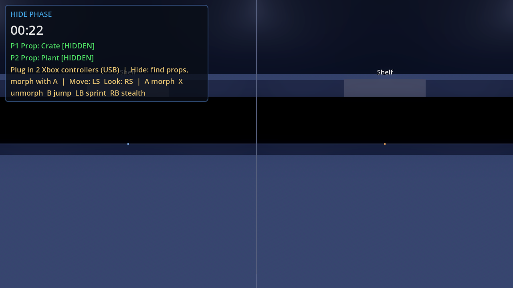
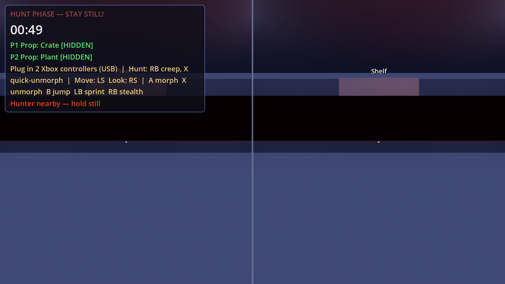
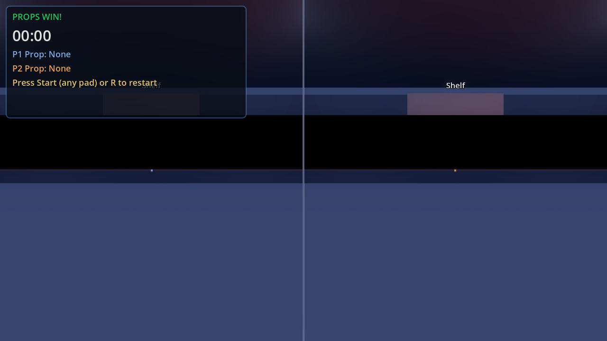
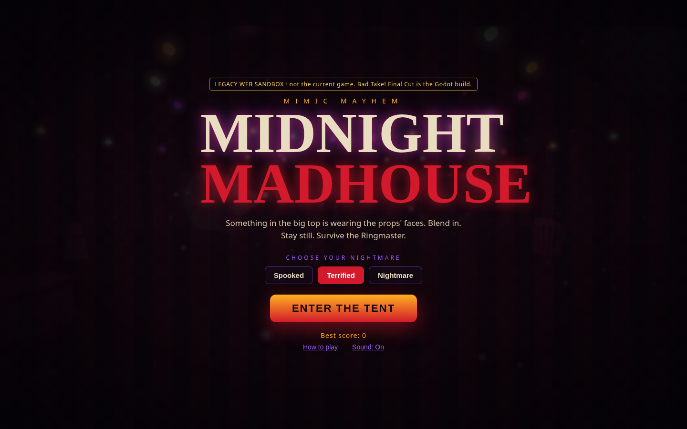

# Mimic Mayhem / Bad Take

- **Repo:** `bad-take-final-cut`
- **Branch:** `main`
- **Exact HEAD:** `af2c676680fdb345d500f123898882135f9ab667`
- **Commit date:** 2026-11-24T00:26:00+08:00
- **Proof status:** `HAS_PHOTOS_AND_VIDEOS`
- **Photos:** 5
- **Videos:** 1

Prop-hunt prototype (Godot screenshots + Three.js web build).

## Photos

### `godot/screenshots/01-coop-hide-phase-start.png`

- sha256: `cb71203574a75115103fb0d34aededc4bac40392c1b52d8a24279e351183138c`
- source HEAD: `af2c676`

### `godot/screenshots/02-coop-both-morphed.png`

- sha256: `12bd458cbb701c7c07b10c0cd2a94d8aa49dd90e8e3d56c57c8278e9ec826c9c`
- source HEAD: `af2c676`

### `godot/screenshots/03-coop-hunt-phase.png`

- sha256: `30e420009921c8d52c161b31cd33ca114dd359702ace325a75a2f816d63a0011`
- source HEAD: `af2c676`

### `godot/screenshots/04-coop-props-win.png`

- sha256: `1a36b90042de49f66765c9f7f60e3a69a2dd3e2f3c5d2b9d76bb2abff4795ce4`
- source HEAD: `af2c676`

## Fresh runtime captures (this audit pack)

- Captured at: `2026-11-24T10:45:04.281174+00:00`
- Against exact HEAD: `af2c676680fdb345d500f123898882135f9ab667`
- Tool: Playwright Chromium (software GL)
- Class: `FRESH_RUNTIME_CAPTURE`

### `01-boot-ui.png`

- sha256: `ab3fc638d436fc3bacc23276a8ea7e8fa15162ac2b2984d240af9ac0b7eafc9a`

- [`ui-loop.webm`](fresh-runtime/ui-loop.webm) — sha256 `1a97cfc44c49a6ed22e9edff50686285dbebcf690777821b50950f922013c20c`
