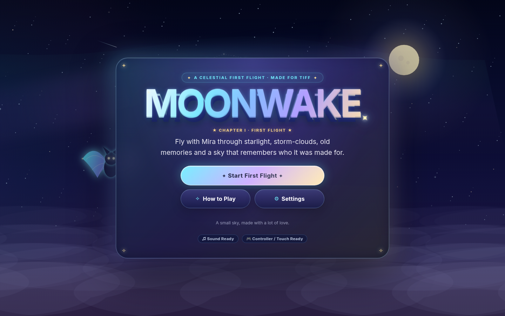
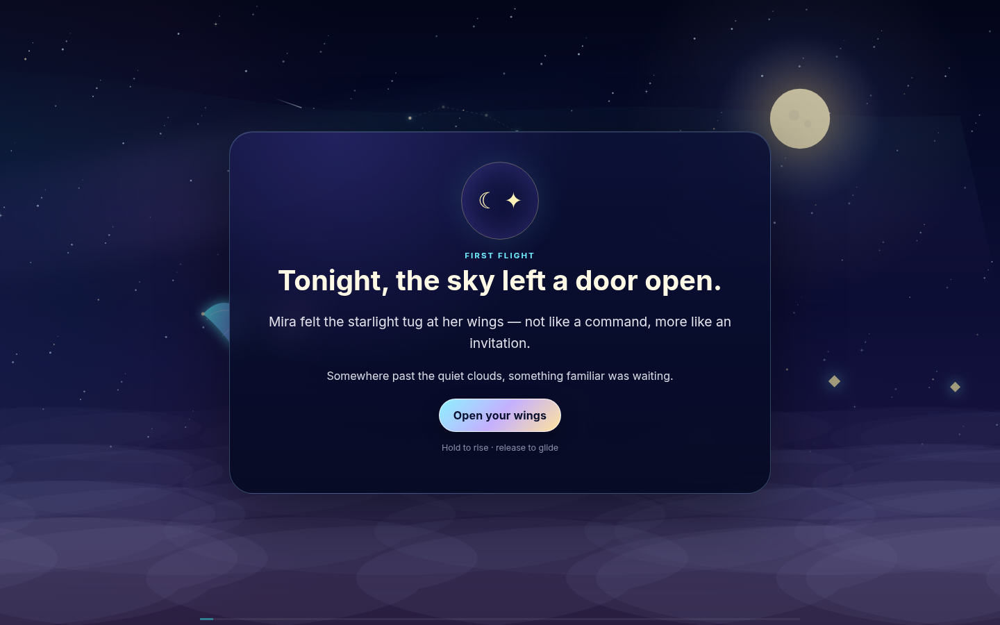

# Moonwake

- **Repo:** `Moonwake`
- **Branch:** `main`
- **Exact HEAD:** `1641594ea1156ac30e2da68812225a340cd76a1d`
- **Commit date:** 2026-10-09T22:46:57+08:00
- **Proof status:** `HAS_PHOTOS_AND_VIDEOS`
- **Photos:** 2
- **Videos:** 1

S.I.R.E.-governed project (no committed UI screenshots found).

## Fresh runtime captures (this audit pack)

- Captured at: `2026-11-24T10:44:45.052155+00:00`
- Against exact HEAD: `1641594ea1156ac30e2da68812225a340cd76a1d`
- Tool: Playwright Chromium (software GL)
- Class: `FRESH_RUNTIME_CAPTURE` — useful for audit; not LAW phone/release certification.

### `01-boot-ui.png`

- sha256: `cdad4c565c5be8504f0574a79a138a87f1dfed58e6f7888ba5dbfce8f0481487`

### `02-after-cta.png`

- sha256: `5726fbacb07828d8957299e89f14a357305e3589336c34eacc1c8282aca5629f`

- [`ui-loop.webm`](fresh-runtime/ui-loop.webm) — sha256 `de598ed9f6898c1ea1d30166a0ee80b391c9872b3a9f85e564170ba8acfb8fa3`
