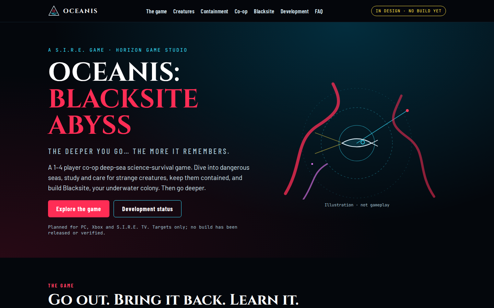
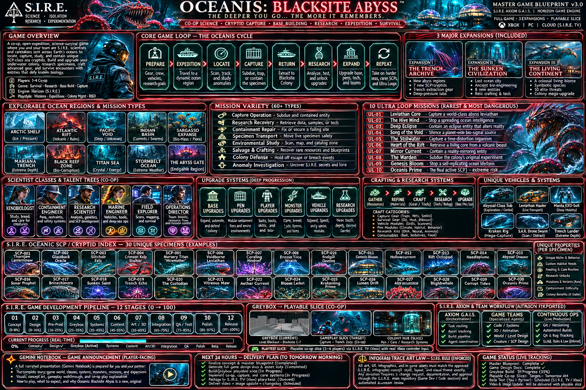
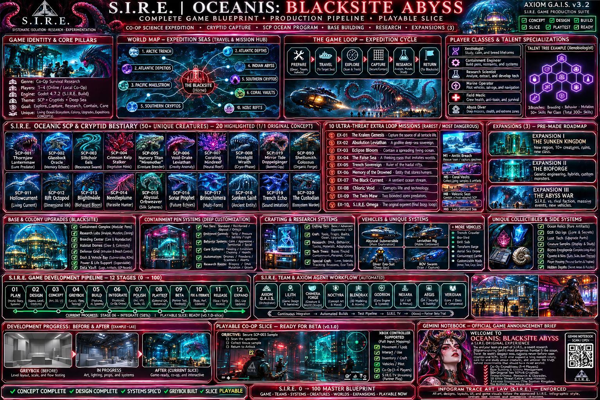

# OCEANIS

- **Repo:** `OCEANIS`
- **Branch:** `main`
- **Exact HEAD:** `2d7a8590491f9e6c99ba19173dae4c13f0a6e725`
- **Commit date:** 2026-11-23T02:47:44+00:00
- **Proof status:** `HAS_PHOTOS_ONLY`
- **Photos:** 3
- **Videos:** 0

KRAIT Godot ocean game (no committed UI screenshots in this checkout).

## Design / blueprint visuals

- Captured/copied at: `2026-11-24T11:18:11.730063+00:00`
- Class: design HTML screenshot + SIRE blueprint PNGs
- **Not gameplay UI** — OCEANIS main still has no playable Godot project in this checkout

