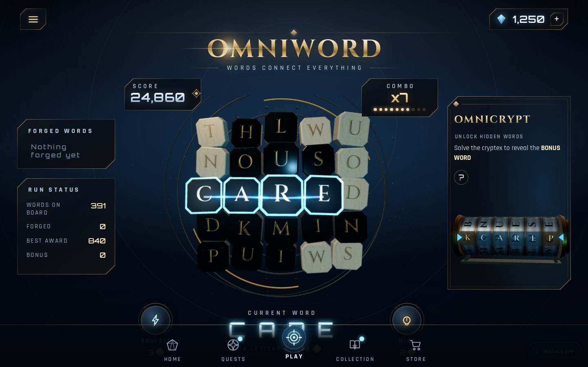

# OmniWord

- **Repo:** `OmniWord`
- **Branch:** `buildforge/omniword-cloudflare-20260906-231623`
- **Exact HEAD:** `8dc9c9abc78e750a32c6624b2387134ca05dab52`
- **Commit date:** 2026-09-07T21:52:13+08:00
- **Proof status:** `HAS_PHOTOS_AND_VIDEOS`
- **Photos:** 2
- **Videos:** 1

Writing / cryptex web app (no committed UI screenshots found).

## Fresh runtime captures (this audit pack)

- Captured at: `2026-11-24T10:44:45.052155+00:00`
- Against exact HEAD: `8dc9c9abc78e750a32c6624b2387134ca05dab52`
- Tool: Playwright Chromium (software GL)
- Class: `FRESH_RUNTIME_CAPTURE` — useful for audit; not LAW phone/release certification.

### `01-boot-ui.png`

- sha256: `cb20f273873ec42caa408c17a19fe0a3c05f19a872678b20c3708ce02c0983a8`

### `02-after-cta.png`

- sha256: `3589b6c1e10443db2fe86a5a4d4fc74add177ef02c1a0620557fe74f17eee6eb`

- [`ui-loop.webm`](fresh-runtime/ui-loop.webm) — sha256 `7cd12e86eb3721e8a82b9037d4850f0246b62c7d229f965c55fa339e59eec099`
