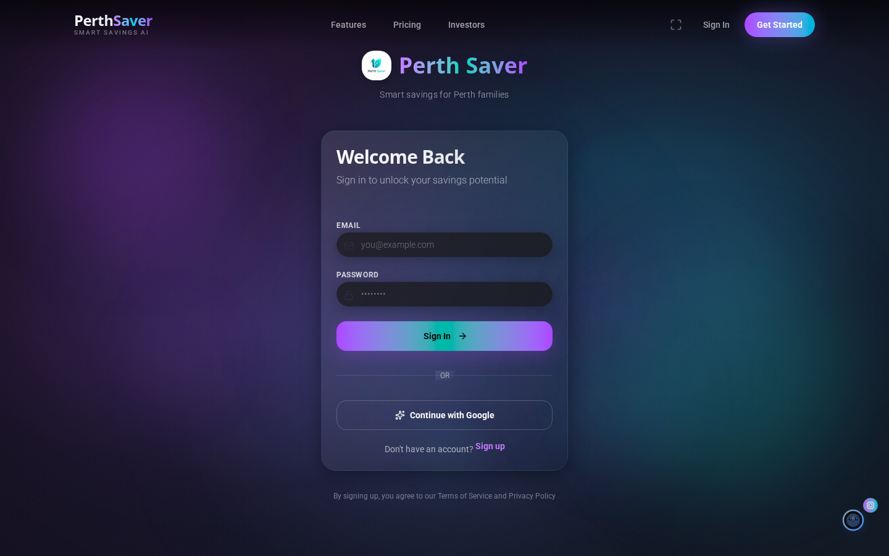

# PerthSaver

- **Repo:** `PERTHSAVER`
- **Branch:** `main`
- **Exact HEAD:** `2a3fad8bcb1e9ba4ad76ed534c608502d9ecb10a`
- **Commit date:** 2026-08-09T01:13:32+08:00
- **Proof status:** `HAS_PHOTOS_AND_VIDEOS`
- **Photos:** 3
- **Videos:** 1

Perth savings / deals platform (limited committed UI proof in-repo).

## Photos

### `client/public/opengraph.jpg`

- sha256: `8316d82252d5be8b8d242fc26f9a1cf99556a546fcf33eaee26893937f6ebd59`
- source HEAD: `2a3fad8`

## Fresh runtime captures (gap fill)

- Captured at: `2026-11-24T11:18:11.730063+00:00`
- Against exact HEAD: `2a3fad8bcb1e9ba4ad76ed534c608502d9ecb10a`
- Tool: Playwright Chromium against Vite client

- [ui-loop.webm](fresh-runtime/ui-loop.webm)
