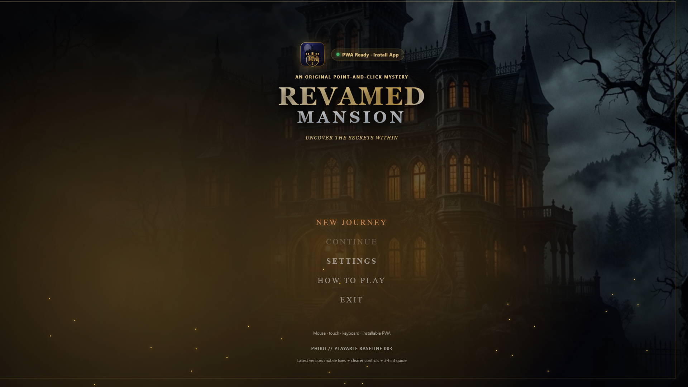
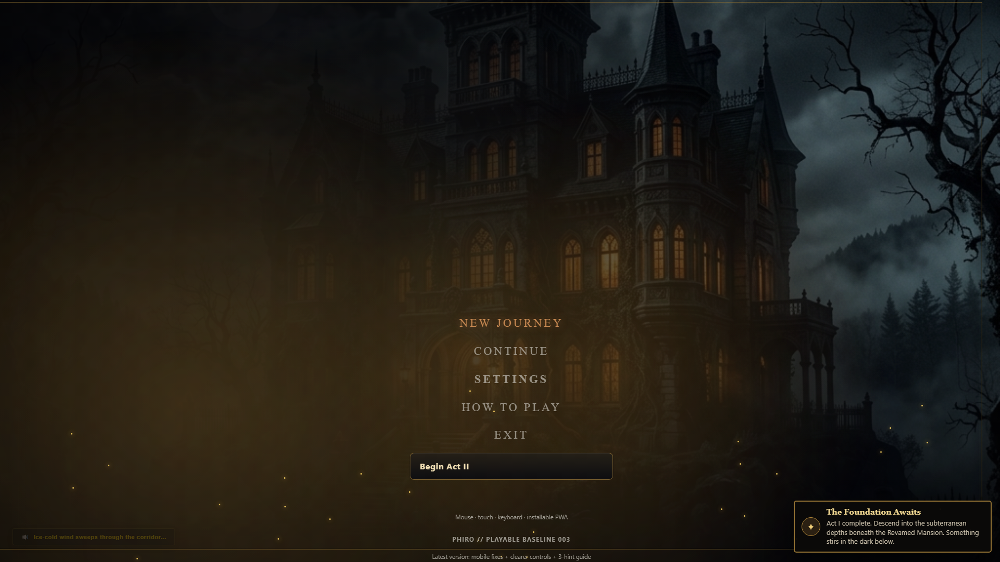
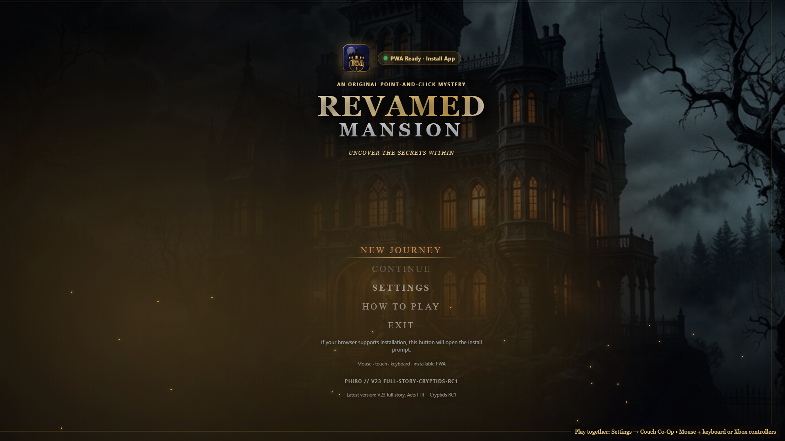
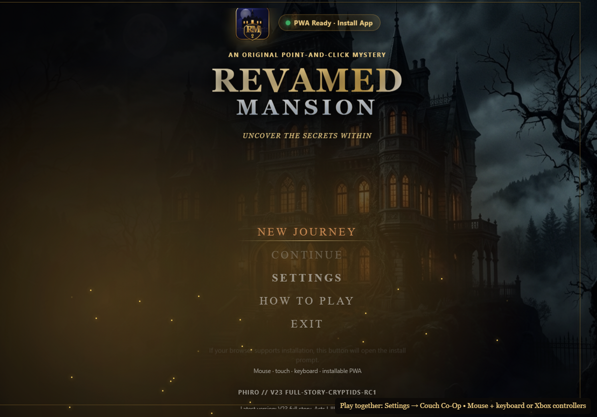

# Revamed Mansion

- **Repo:** `Revamed-Mansion`
- **Branch:** `main`
- **Exact HEAD:** `62f1344813bd73d4e4de0446a76d6c2095dcdf17`
- **Commit date:** 2026-11-19T16:54:44+08:00
- **Proof status:** `HAS_PHOTOS_ONLY`
- **Photos:** 6
- **Videos:** 0

Family co-op mansion game with SHA-bound desktop/phone evidence.

## Photos

### `docs/evidence/f2b95cbdc8d0c037c449c1b7527eb2654b07a63e/desktop-1920x1080/00-title-screen.png`

- sha256: `7e0576236e9f9d18d97bc4d66199d8bcbc257772a82bb6478c5b16742f1cb25e`
- source HEAD: `62f1344`

### `docs/evidence/f2b95cbdc8d0c037c449c1b7527eb2654b07a63e/desktop-1920x1080/19-act2-continuation-unlocked.png`

- sha256: `b4a19d5962b48eda5417d90f50dfc57c1cd3eb5e020cd2d4ab32eff233c2d3c6`
- source HEAD: `62f1344`

### `docs/sire-layout-sweep-20261011/desktop.png`

- sha256: `cbe2e5d0e0bc4fdca9de636c08e878fefca89fc0aabe20a7f42a2686af4f0fe1`
- source HEAD: `62f1344`

### `docs/sire-layout-sweep-20261011/phone-portrait.png`

- sha256: `f1895d516db521c9f781b3c939e4943c4667b13127e6cb668bd15b727ede9af9`
- source HEAD: `62f1344`

### `docs/sire-layout-sweep-20261011/tablet-landscape.png`

- sha256: `c010506ef6f3aa926afd2a85a2a5d3505030a2f685cf737f0b3e0331f2b7742b`
- source HEAD: `62f1344`

### `docs/family-coop-demo-20261011.png`

- sha256: `7f666d60d0e69b2ab8212ee037441c03333bb4b52dc05076cbea089e2a2eaf15`
- source HEAD: `62f1344`
