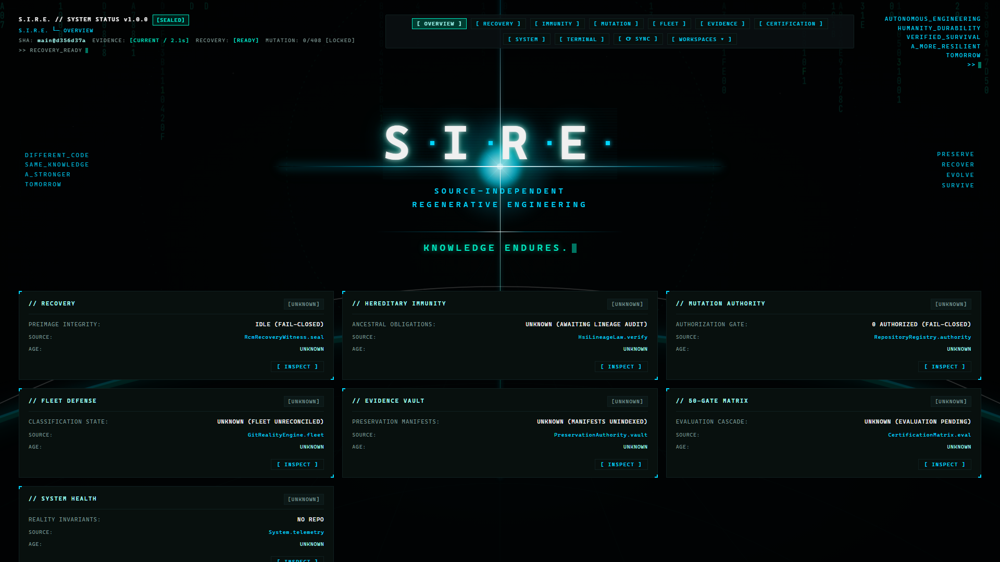
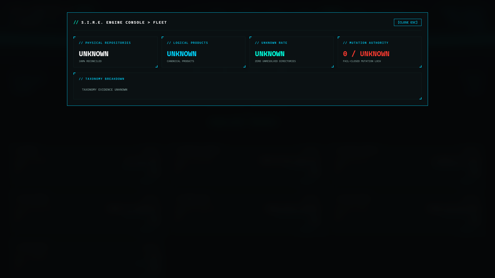
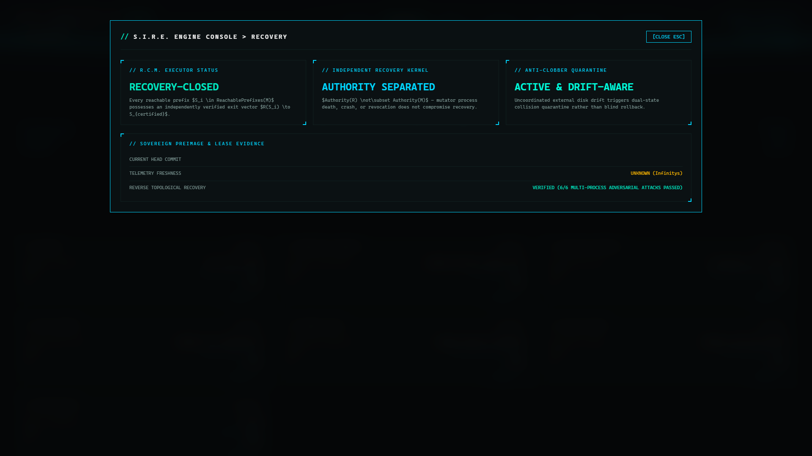
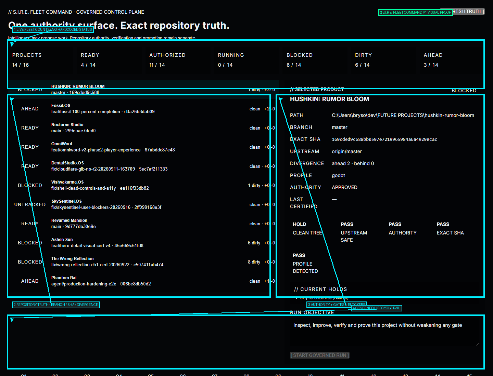

# S.I.R.E.

- **Repo:** `SIRE`
- **Branch:** `main`
- **Exact HEAD:** `a622efe8378f8ff0617a884763907faeda3e6d3e`
- **Commit date:** 2026-11-24T14:26:07+08:00
- **Proof status:** `HAS_PHOTOS_ONLY`
- **Photos:** 7
- **Videos:** 0

Sovereign engineering laws, control surfaces, and certification tooling.

## Photos

### `evidence/sire-horizon-certification/01_SPLASH.png`

- sha256: `0935c1cc3381a75d8060c611f180ac8c5415c28b601d3f21ec55525776c371bc`
- source HEAD: `a622efe8`

### `evidence/sire-horizon-certification/02_MAIN_1920x1080.png`

- sha256: `37884702873e8b4ee778cdc2a863b245c0a47385107902ac7663f3343d39390e`
- source HEAD: `a622efe8`

### `evidence/sire-horizon-certification/08_FLEET.png`

- sha256: `2f409473a63d04a60765f3024f111dd35a9924b0a136902764a4ee22e752a01d`
- source HEAD: `a622efe8`

### `evidence/sire-horizon-certification/09_PRESERVATION.png`

- sha256: `cef9e4cefc4dc6e121f436fb96071e569e5658990a00568fc14cf9c2d57b56f0`
- source HEAD: `a622efe8`

### `evidence/sire-horizon-certification/10_RECOVERY.png`

- sha256: `91b2f7f75d453cc402db7acb4b00a1d5b45117e672cca60becdb5b4eb46f0777`
- source HEAD: `a622efe8`

### `evidence/fleet-command-v1/fleet-command-proof-annotated.png`

- sha256: `4ac3cb075b79e90c9cbdf6fc60ff12a051ec2821f50aff07d14f8dbd320cb310`
- source HEAD: `a622efe8`

### `sire-web/src/assets/hero.png`

- sha256: `881ffbcaafc212e49addad08846a5b82761355fa20624253af3477ba33262c5c`
- source HEAD: `a622efe8`
