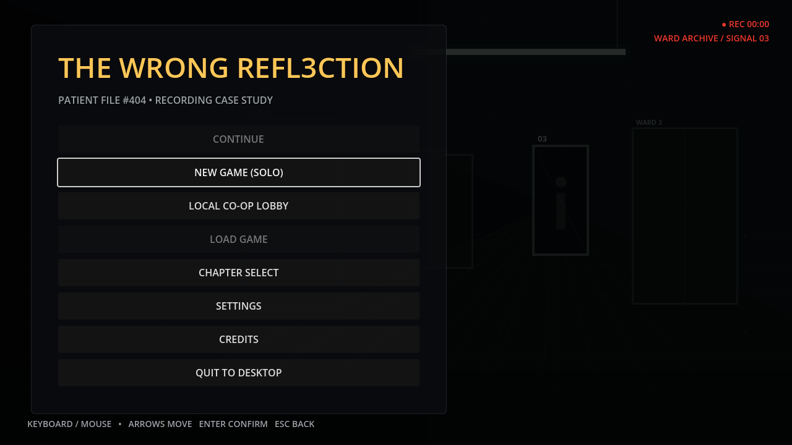
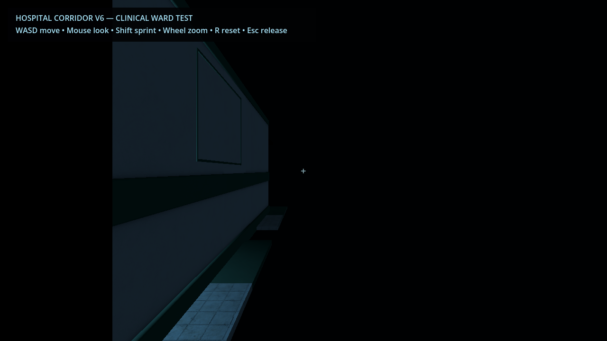
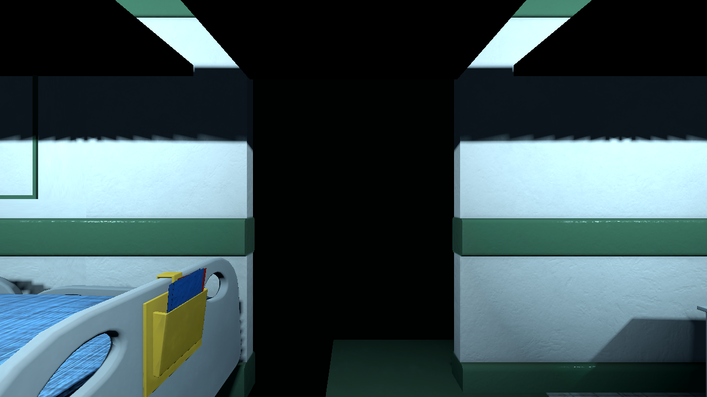
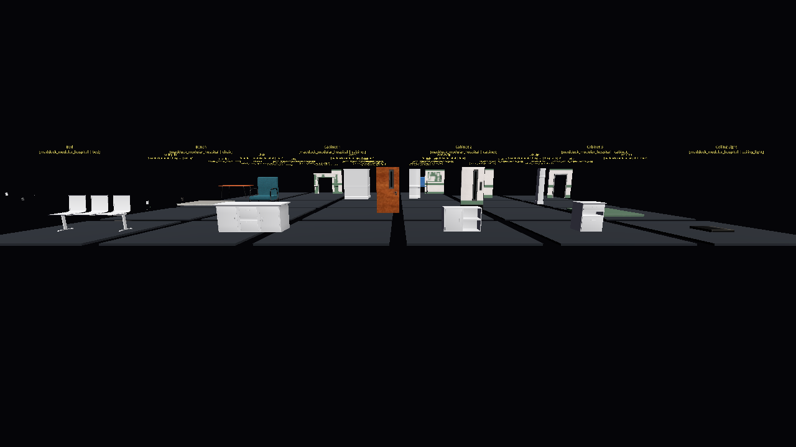
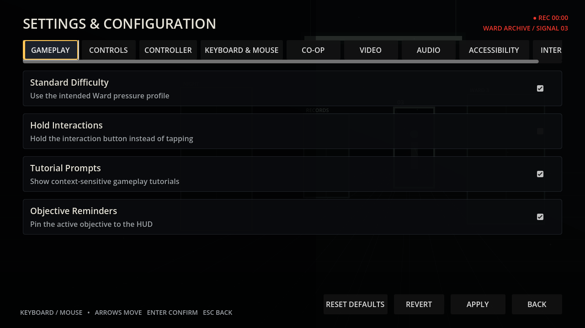
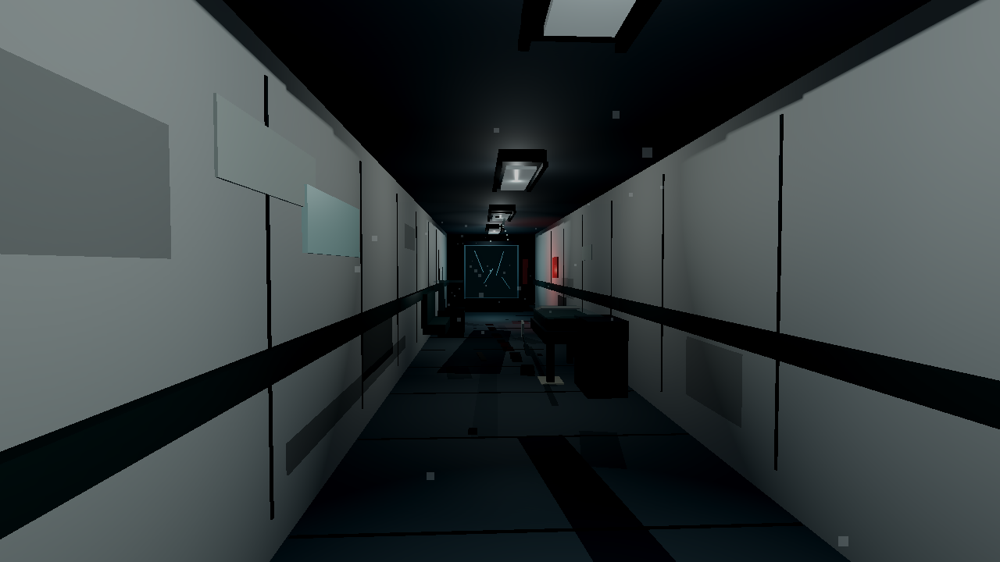
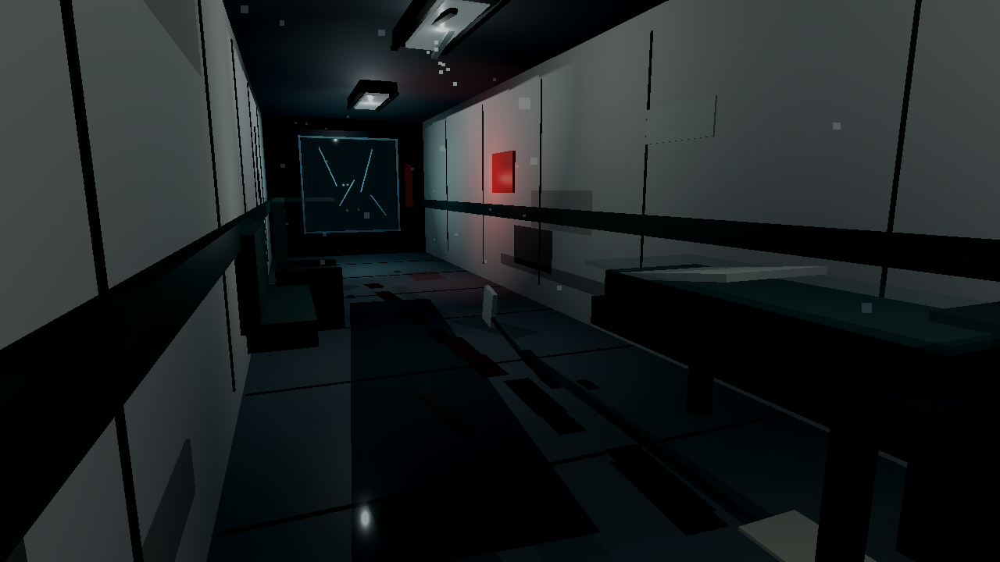

# The Wrong Reflection

- **Repo:** `The-Wrong-Refl3ction`
- **Branch:** `main`
- **Exact HEAD:** `e46dc328b2f85dcefe8a115970004c2f252fa6c4`
- **Commit date:** 2026-10-28T07:35:18+08:00
- **Proof status:** `HAS_PHOTOS_ONLY`
- **Photos:** 8
- **Videos:** 0

Horror mirror/co-op game with visual_proof screenshot set.

## Photos

### `reports/visual_proof/01_Title_Screen.png`

- sha256: `409ad12fd6569b82219a25ca136410c33c8774519315adade5ddaa4029699572`
- source HEAD: `e46dc32`

### `reports/visual_proof/07_Darkroom.png`

- sha256: `22018e0455db21d910368fc323fc286df53c839097ffe073106ea04489685c31`
- source HEAD: `e46dc32`

### `reports/visual_proof/08_Isolation_Corridor.png`

- sha256: `8c3e0ad80c704c01e3a745a2b5b35fd0dc0f66aa786826926c489c242d00af70`
- source HEAD: `e46dc32`

### `reports/visual_proof/15_Mirror_Court.png`

- sha256: `ff7b8303dd9e740e7f27ea79187ac3bc3f5e300be7ce2b2b945be33982b76a1e`
- source HEAD: `e46dc32`

### `reports/visual_proof/19_Pause_Settings.png`

- sha256: `35dd9bdf114f37901c5e2c274540bae18bc3fae6b8f9531a9a5b3ba237836549`
- source HEAD: `e46dc32`

### `reports/visual_proof/20_Split_Screen_CoOp.png`

- sha256: `d37cbb331d2eaae5a9fce2006b75d3288f22601bb51087a94a704bd4d4936fd7`
- source HEAD: `e46dc32`

### `reports/game_screenshots_and_proof/evidence_01_entry_cinematic.png`

- sha256: `89a8e398055ef2a93a81bd446db3026934b240054002f9f6a7c1c5acc7eb2145`
- source HEAD: `e46dc32`

### `reports/game_screenshots_and_proof/evidence_02_story_event.png`

- sha256: `0f7b1d08d9618798eacd636d4ae334ef7acdd7e690de69c797cae87fdf0d77b3`
- source HEAD: `e46dc32`
