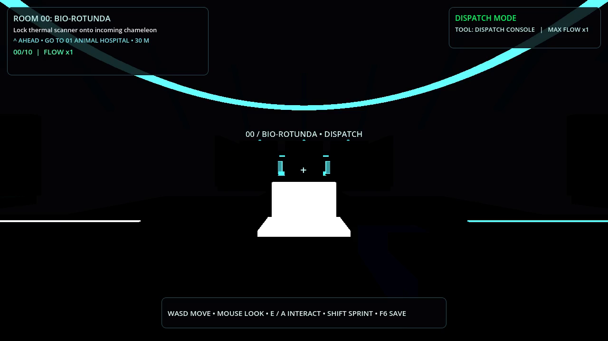

# VENOMWARD

- **Repo:** `venomward`
- **Branch:** `sire/build-venomward`
- **Exact HEAD:** `4ec51240d7c6ff513222231f7f1314824013c109`
- **Commit date:** 2026-11-24T14:26:03+08:00
- **Proof status:** `HAS_PHOTOS_AND_VIDEOS`
- **Photos:** 4
- **Videos:** 1

KRAIT Godot game on sire/build-venomward (no committed UI screenshots).

## Godot engine capture

- Captured at: `2026-11-24T11:18:11.730063+00:00`
- Against exact HEAD: `4ec51240d7c6ff513222231f7f1314824013c109`
- Engine: Godot 4.7.2.stable (SHA-256 `8d106cbe…f71e`)
- Scope: `ACTUAL_ENGINE_WINDOW_CAPTURE` via `tools/capture_real_godot_video.sh`
- Release: BLOCKED pending phone + independent review

- [venomward-real-scene.mp4](fresh-runtime/venomward-real-scene.mp4)
- [capture-receipt.json](fresh-runtime/capture-receipt.json)

## Cross-repo historical (SIRE)

Earlier VENOM UI shots stored under SIRE `artifacts/venom-v16-live` / `sire-web/evidence/v15` — useful context, not exact-HEAD certification of this standalone repo.
