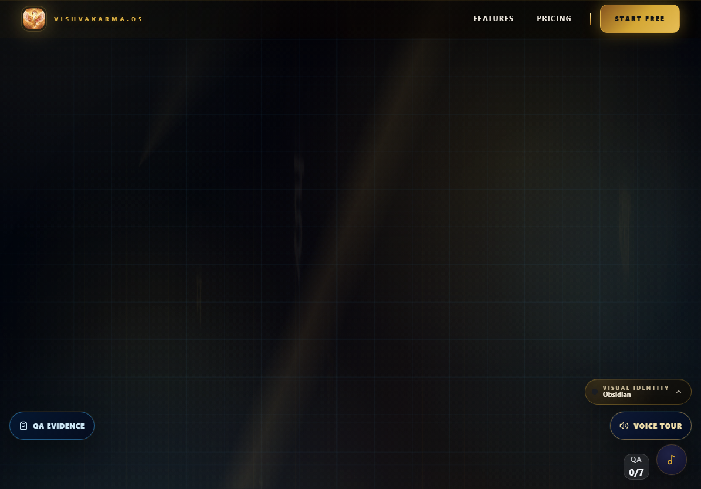
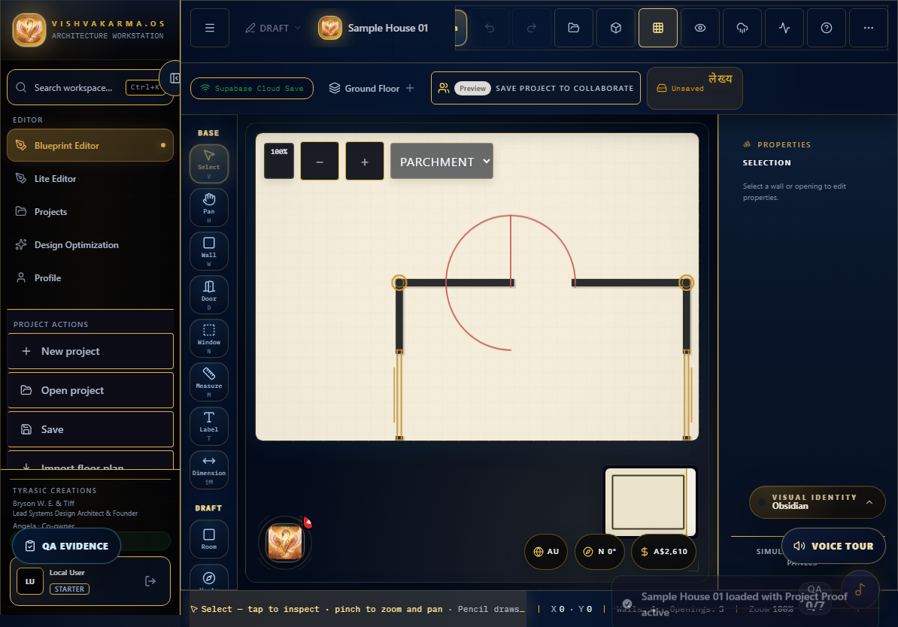
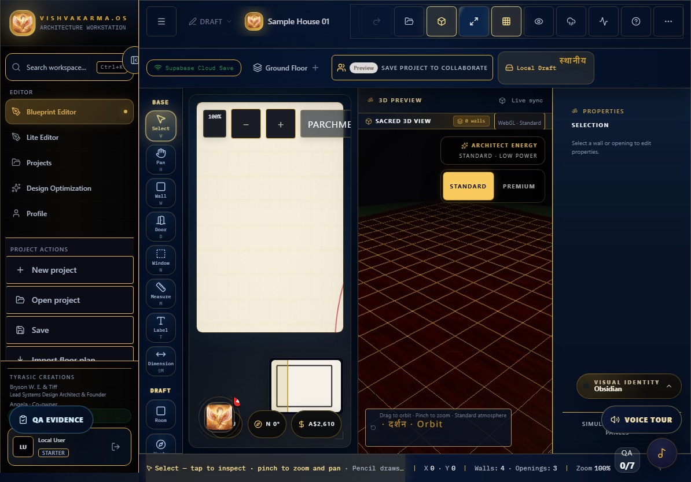
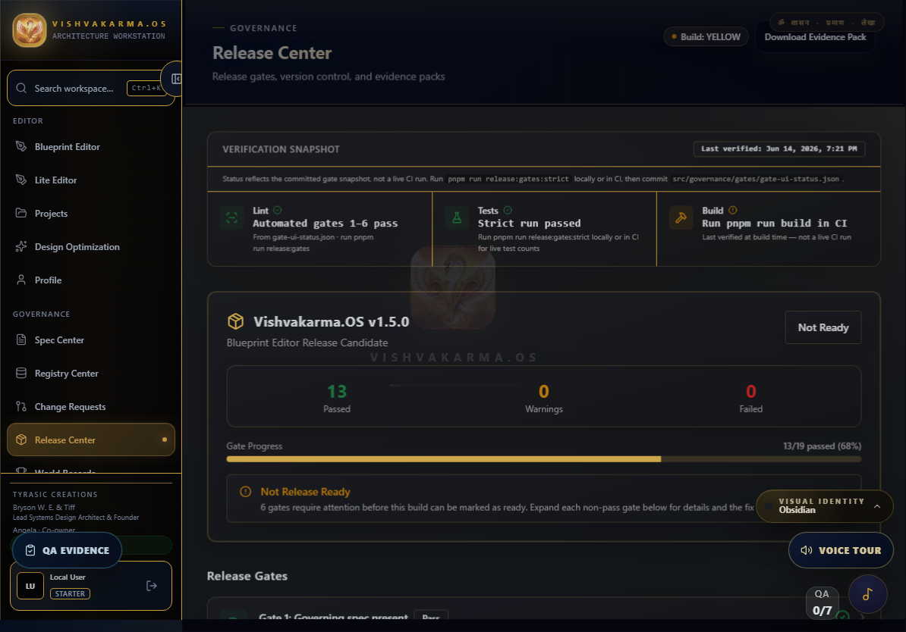
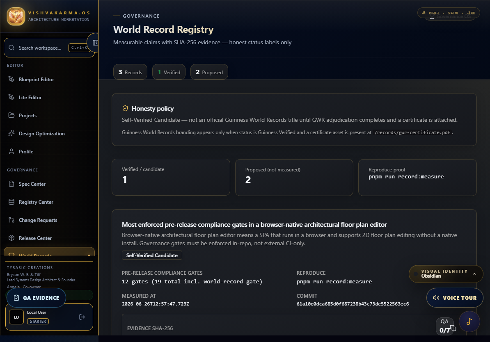
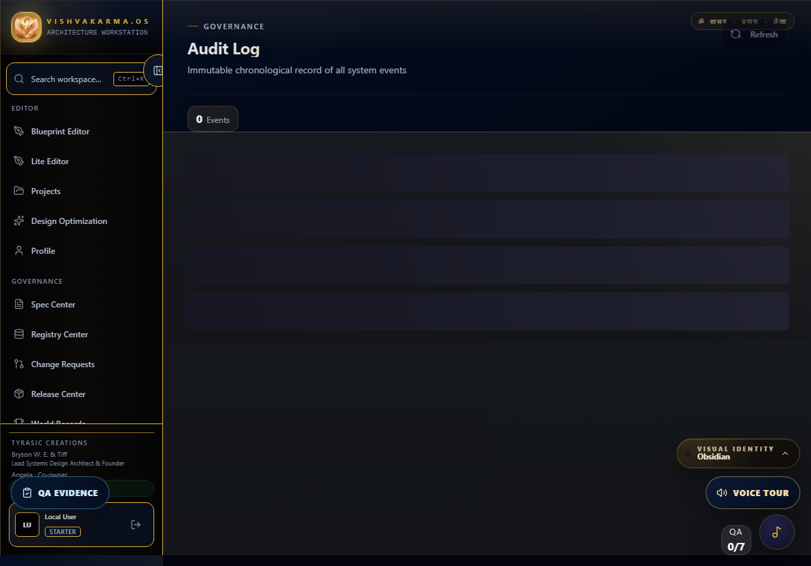

# Vishvakarma.OS

- **Repo:** `vishvakarma-os`
- **Branch:** `main`
- **Exact HEAD:** `3bf5153c04f00a19fa12d2bb2551ea420a632363`
- **Commit date:** 2026-09-27T22:38:34+08:00
- **Proof status:** `HAS_PHOTOS_ONLY`
- **Photos:** 8
- **Videos:** 0

Browser-native architectural planning and 3D review workstation.

## Photos

### `docs/release/evidence/screenshots/01-landing-hero.png`

- sha256: `e94234f0705389d3aaa2531c6d77cb75d426a9625e97d4de0ca9db3def176f76`
- source HEAD: `3bf5153c0`

### `docs/release/evidence/screenshots/03-editor-2d-sample.png`

- sha256: `c50d5562dafdcd65145af7eee63826d889feca2eaccf1d549595d5412e6b90dd`
- source HEAD: `3bf5153c0`

### `docs/release/evidence/screenshots/04-editor-3d-premium.png`

- sha256: `94d6ca9988525b53ba92ee004e532bd61c892e256ec717657b4d347e55246758`
- source HEAD: `3bf5153c0`

### `docs/release/evidence/screenshots/02-auth-email-link.png`

- sha256: `8f4a36eb5c86db74e2497398e60ed130630006ff227deefb6b94e6bdd20f3751`
- source HEAD: `3bf5153c0`

### `docs/release/evidence/screenshots/09-pricing-tiers.png`

- sha256: `42af456c97a173c0cfb14c96625236965e559e6dfbded68532f17cdc4ff7d37f`
- source HEAD: `3bf5153c0`

### `docs/release/evidence/screenshots/11-releases.png`

- sha256: `4c7ca947ee524351aaf9d21dfec4d43310cd417bba3d4eff9d5c26dac7581945`
- source HEAD: `3bf5153c0`

### `docs/release/evidence/screenshots/12-world-records.png`

- sha256: `588a71f43506b5fb109f5c14d56a02192415cf92caf5cfc569d8c91e2e181a9f`
- source HEAD: `3bf5153c0`

### `docs/release/evidence/screenshots/13-audit.png`

- sha256: `c7427531211bb4563abec630aca0a552fe0eefdc890661c55ad4854c025f726b`
- source HEAD: `3bf5153c0`
